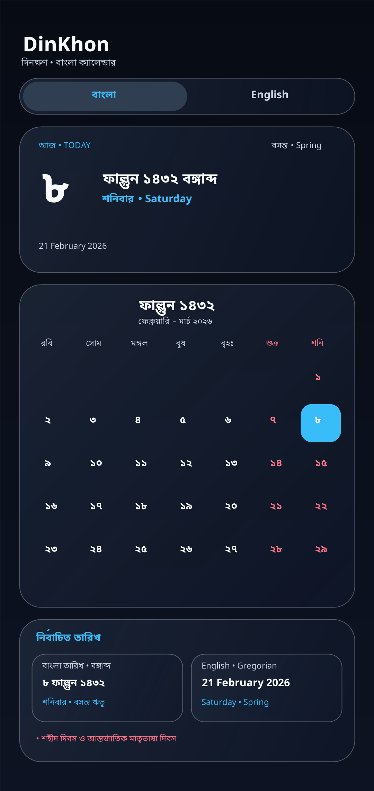
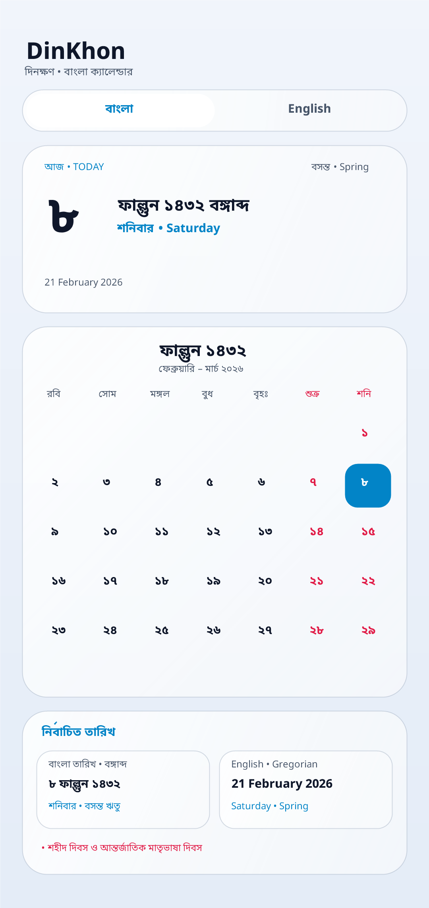
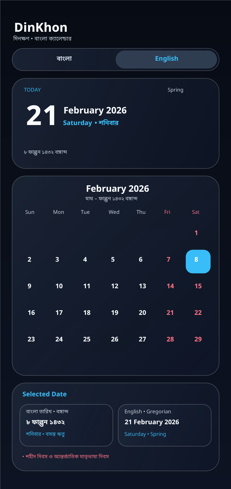
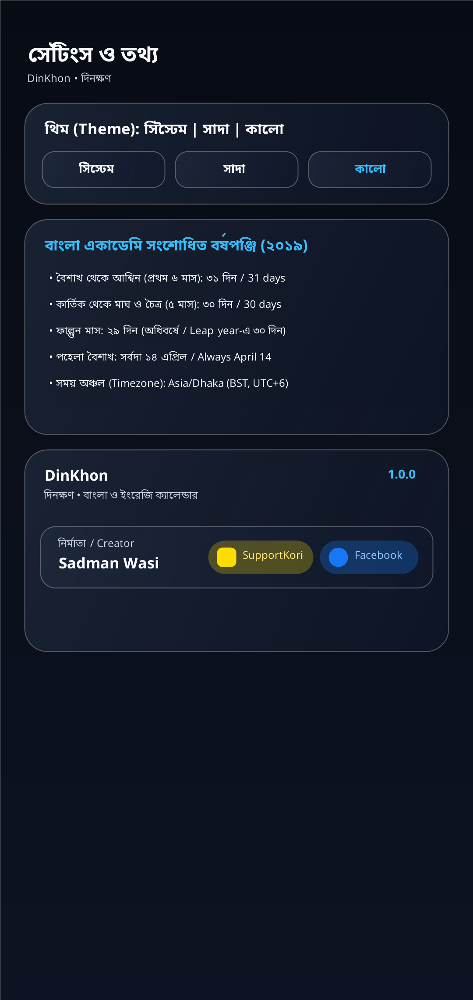

# DinKhon (দিনক্ষণ • বাংলা ক্যালেন্ডার) — Bangla Calendar

[](LICENSE)
[-3DDC84.svg)](app/build.gradle.kts)
[](build.gradle.kts)
[](app/build.gradle.kts)
[](PRIVACY.md)

<p align="center">
  
</p>

**DinKhon (`দিনক্ষণ • বাংলা ক্যালেন্ডার` / Bangla Calendar)** is a fast, 100% offline, ad-free, and open-source native Android calendar application featuring an **Apple-inspired Liquid Glass** interface and the official **2019 Revised Bangladesh Bangla Academy Calendar (`বঙ্গাব্দ`)** with instant two-way **Bangla ↔ English (Gregorian)** date conversion.

<p align="center">
  <a href="https://github.com/sadWasi/DinKhon/releases/download/v1.0.0/app-release.apk"></a>
</p>

<p align="center">Free • Open source • No ads • No internet permission</p>

- **Application ID (`package`):** `dinkhon.sadmanwasi.app`
- **Current Release:** `1.0.0` (`versionCode = 10`)
- **Creator:** **Sadman Wasi** ([SupportKori](https://www.supportkori.com/sadmanwasi) • [Facebook](https://www.facebook.com/s4dmanwasi))

---

## 📸 Screenshots

| Bangla Mode (Dark • কালো) | Bangla Mode (Light • সাদা) | English Mode (Gregorian) | Settings & Creator Info |
| :---: | :---: | :---: | :---: |
|  |  |  |  |

---

## ✨ Main Features

### 1. Official 2019 Revised Bangladesh Bangla Academy Calendar
Implements the official calendar rules adopted by the Government of the People's Republic of Bangladesh and Bangla Academy (2019 revision):

| ক্রম | বাংলা মাস (Month) | English Transliteration | দিন সংখ্যা (Days) | ষড়ঋতু (Season) | Gregorian Start Date |
| :--- | :--- | :--- | :--- | :--- | :--- |
| ১ | **বৈশাখ** | Boishakh | ৩১ (31) | গ্রীষ্ম (Summer) | 14 April |
| ২ | **জ্যৈষ্ঠ** | Jyoishtho | ৩১ (31) | গ্রীষ্ম (Summer) | 15 May |
| ৩ | **আষাঢ়** | Asharh | ৩১ (31) | বর্ষা (Monsoon) | 15 June |
| ৪ | **শ্রাবণ** | Shrabon | ৩১ (31) | বর্ষা (Monsoon) | 16 July |
| ৫ | **ভাদ্র** | Bhadro | ৩১ (31) | শরৎ (Autumn) | 16 August |
| ৬ | **আশ্বিন** | Ashwin | ৩১ (31) | শরৎ (Autumn) | 16 September |
| ৭ | **কার্তিক** | Kartik | ৩০ (30) | হেমন্ত (Late Autumn) | 17 October |
| ৮ | **অগ্রহায়ণ** | Ogrohayon | ৩০ (30) | হেমন্ত (Late Autumn) | 16 November |
| ৯ | **পৌষ** | Poush | ৩০ (30) | শীত (Winter) | 16 December |
| ১০ | **মাঘ** | Magh | ৩০ (30) | শীত (Winter) | 15 January |
| ১১ | **ফাল্গুন** | Falgun | ২৯ (29) / ৩০ (30 in Leap Year) | বসন্ত (Spring) | 14 February |
| ১২ | **চৈত্র** | Choitro | ৩০ (30) | বসন্ত (Spring) | 15 March |

- **পহেলা বৈশাখ (1 Boishakh)** always begins on **14 April**.
- **অধিবর্ষ (Leap Year Rule)**: Whenever the Gregorian year containing February (`BanglaYear + 594`) is a leap year, **ফাল্গুন (Falgun)** has **৩০ days** instead of ২৯ days.
- **Timezone**: Uses `Asia/Dhaka` (`UTC+6`) when determining today's date.

### 2. Instant `বাংলা | English` Mode Toggle & Two-Way Date Converter
- Prominent segmented glass switch at the top of the home screen toggles between the **Bangla Calendar (বঙ্গাব্দ)** and the **English Calendar (Gregorian)**.
- **Preserves Selected Date**: Switching modes keeps the exact same real-world date selected while converting numerals, month grids, weekdays, and seasons.
- **Interactive Date Converter & Quick Jump**: Convert and jump to any historical or future Bangla or Gregorian date (`1300–1600 বঙ্গাব্দ`).

### 3. Apple-Inspired Liquid Glass UI & 60/120Hz Smooth Animations
- Frosted translucent cards (`LiquidGlassCard`) with hardware-cached radial shaders (`drawWithCache`), specular top-edge optical highlights, and delicate rim borders.
- Supports **System (`সিস্টেম`)**, **Light (`সাদা`)**, and **Dark (`কালো`)** themes.
- Interactive finger-follow month swiping and `withFrameNanos`-synchronized GPU `graphicsLayer` transitions.
- Universal **Adaptive Icon** + **Android 13+ Material You `<monochrome>` Themed Icon** support.
- Bundled **Noto Sans Bengali** typeface (`res/font/noto_sans_bengali.ttf`) for crisp Bengali conjuncts (যুক্তাক্ষর) and numerals (`০ ১ ২ ৩ ৪ ৫ ৬ ৭ ৮ ৯`).

---

## 🛠️ Technology Stack

- **Language:** Kotlin `2.0.21` (`JVM Target 17`, K2 + `org.jetbrains.kotlin.plugin.compose` `2.0.21`)
- **UI Framework:** Jetpack Compose (`BOM 2024.10.01`) + Material 3 customized with `GlassTheme`
- **Architecture:** Clean Architecture / Unidirectional Data Flow (`StateFlow` + `@Immutable` models + Compose Stability Config)
- **Date Engine:** Pure Kotlin + `java.time` (`LocalDate`, `YearMonth`, `IsoChronology`, `ZoneId.of("Asia/Dhaka")`)
- **Android SDK:** `minSdk = 26` (Android 8.0), `targetSdk = 36` (Android 16), `compileSdk = 36` (Android 16)
- **Build System:** Gradle `8.11.1` + Android Gradle Plugin `8.9.1`

---

## 📥 Download, Installation & F-Droid Availability

### Download for Android

<p align="center">
  <a href="https://github.com/sadWasi/DinKhon/releases/latest"></a>
</p>

1. Open the **[latest GitHub Release](https://github.com/sadWasi/DinKhon/releases/latest)**.
2. Under **Assets**, download the `.apk` file (not the source-code ZIP files).
3. Open the downloaded APK on your Android phone and follow Android's installation prompt. You may need to allow your browser or file manager to install apps from that source.

**Compatibility:** Android 8.0 (API 26) or newer.

For checksum and APK-signature verification, see the [Release Signing & Verification Guide](distribution/GitHub/RELEASE_SIGNING_GUIDE.md).

### F-Droid

DinKhon is **not currently available on F-Droid**. Its initial inclusion request was closed because the project had not yet met F-Droid's three-month active-maintenance requirement. Development continues, and a future submission may be made once the policy requirements are met. See the [F-Droid Inclusion Policy](https://f-droid.org/docs/Inclusion_Policy/).

---

## 🚀 Build & Test Instructions

### Prerequisites
- **JDK 17+** (verified with OpenJDK Temurin 17 and 21 LTS)
- **Android SDK Platform 36 (Android 16)** and **Build-Tools 36.0.0**

### 1. Run Unit Tests
Verifies reference dates (`16 Dec 2025 = ১ পৌষ ১৪৩২`, `21 Feb 2026 = ৮ ফাল্গুন ১৪৩২`, `26 Mar 2026 = ১২ চৈত্র ১৪৩২`, `14 Apr 2026 = ১ বৈশাখ ১৪৩৩`, `17 Oct 2026 = ১ কার্তিক ১৪৩৩`), all 12 month start dates and lengths, century leap-year rules, `Asia/Dhaka` midnight boundaries, and multi-decade daily round-trip conversions:

```bash
./gradlew testDebugUnitTest
```

### 2. Build Debug & Release APKs / AAB
```bash
./gradlew assembleDebug assembleRelease bundleRelease
```

Build outputs:
- **Debug APK:** `app/build/outputs/apk/debug/app-debug.apk`
- **Release APK:** `app/build/outputs/apk/release/app-release.apk` (when `keystore.properties` is present) or `app/build/outputs/apk/release/app-release-unsigned.apk` (clean unsigned source build)
- **Release AAB:** `app/build/outputs/bundle/release/app-release.aab`

---

## 🏗️ Project Structure

```text
BanglaCalendar/
├── .github/workflows/
│   └── android-ci.yml                  # GitHub Actions CI & artifact build workflow
├── app/
│   ├── compose_stability.conf          # Compose compiler stability definitions
│   ├── proguard-rules.pro              # R8 / ProGuard optimization rules
│   └── src/
│       ├── main/                       # Application source code, Noto Sans Bengali font & adaptive icons
│       ├── test/                       # JUnit 4 unit tests (BanglaCalendarEngineTest & CalendarViewModelTest)
│       └── androidTest/                # Jetpack Compose UI instrumentation tests
├── distribution/
│   ├── F-Droid/                        # Proposed fdroiddata YAML & F-Droid submission guide
│   └── GitHub/                         # Release signing guide & v1.0.0 release notes
├── docs/
│   └── PROJECT_AUDIT_REPORT.md         # Full technical, security, privacy & F-Droid audit report
├── fastlane/metadata/android/
│   ├── en-US/                          # English Fastlane / F-Droid descriptions, changelogs & graphics
│   └── bn-BD/                          # Bengali Fastlane / F-Droid descriptions & changelogs
├── screenshots/                        # Application screenshots & high-resolution icon
├── CHANGELOG.md                        # Version history
├── CONTRIBUTING.md                     # Contribution guidelines
├── LICENSE                             # Official Apache License, Version 2.0
├── NOTICE                              # Attribution notices
├── PRIVACY.md                          # Code-verified privacy policy
├── README.md                           # Project documentation
├── SECURITY.md                         # Security policy & vulnerability reporting
└── THIRD_PARTY_NOTICES.md              # Third-party dependency & font licence audit
```

---

## 🔒 Privacy

**DinKhon (`Bangla Calendar`)** requests **zero Android permissions** (not even `android.permission.INTERNET`), works 100% offline, and contains no analytics, telemetry, crash-reporting, or advertising libraries. Read the full code-verified policy in [`PRIVACY.md`](PRIVACY.md).

---

## 🤝 Contributing & Reporting Issues

Contributions, bug reports, and feature suggestions are welcome!
- Please read [`CONTRIBUTING.md`](CONTRIBUTING.md) before opening a pull request.
- To report a bug or suggest an improvement, open an issue in the repository's **Issues** tab.
- For security vulnerabilities, please follow [`SECURITY.md`](SECURITY.md).

---

## 📄 Licence

Bangla Calendar is open-source software licensed under the **Apache License, Version 2.0** (`SPDX-License-Identifier: Apache-2.0`).

Copyright 2026 SadmanWasi.

You may use, modify, distribute and commercially reuse this software in accordance with the terms of the licence.

See the [`LICENSE`](LICENSE) file for the complete licence text, [`NOTICE`](NOTICE) for project attribution notices, and [`THIRD_PARTY_NOTICES.md`](THIRD_PARTY_NOTICES.md) for third-party component and font licences. Third-party components and assets are subject to their own licences.
